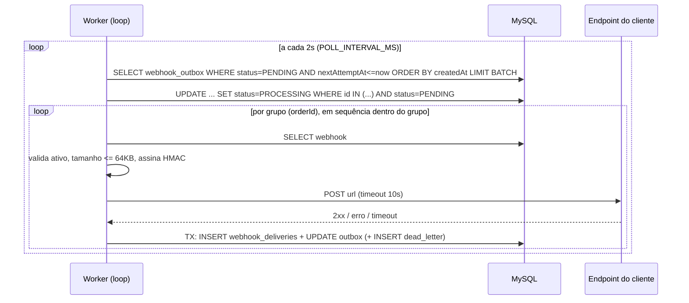

# FDD — Sistema de Webhooks de Notificação de Pedidos

| Campo | Valor |
|---|---|
| **Feature** | Webhooks outbound de mudança de status de pedido |
| **Autor** | Pedro Hubner |
| **Status** | Em revisão. Pronto para implementação depois de fechar as lacunas RFC-L-01 a RFC-L-07 do [RFC](RFC.md#52-lacunas-identificadas-na-elaboração-deste-rfc-para-os-revisores-decidirem)) |
| **Data** | 2026-10-12 |
| **Documentos relacionados** | [PRD](PRD.md) · [RFC](RFC.md) · [ADRs](adrs/README.md) · [Tracker](TRACKER.md) |

> **Convenção deste documento.** Arquivos marcados com **(novo)** ainda não existem e serão criados pela feature. Todos os outros caminhos citados já existem no repositório. Valores marcados como *proposta de implementação* não foram fixados na reunião. São escolhas deste FDD, ajustáveis na revisão.

---

## 1. Contexto e motivação técnica

O OMS (`src/`) é uma API Express + Prisma + MySQL organizada em módulos por domínio (`src/modules/{auth,users,customers,products,orders}`). A mudança de status de pedido acontece num único ponto, `OrderService.changeStatus` (`src/modules/orders/order.service.ts`). Ela roda dentro de `prisma.$transaction`: valida a transição (`src/modules/orders/order.status.ts`), debita ou repõe estoque, atualiza `orders` e insere em `order_status_history`.

Não existe hoje nenhum mecanismo de evento, fila ou chamada HTTP de saída. Os clientes B2B fazem polling em `GET /api/v1/orders` ([09:00] Marcos).

O desafio técnico é publicar um evento por mudança de status com **atomicidade**, sem perda quando a transação commita e sem evento quando ela dá rollback ([09:40] Bruno). A entrega HTTP não pode acontecer dentro da transação, porque um cliente lento travaria a transação e um cliente fora do ar forçaria rollback ([09:04] Bruno). As decisões que respondem a isso estão nos [ADR-001](adrs/ADR-001-outbox-transacional-no-mysql.md) a [ADR-007](adrs/ADR-007-snapshot-do-payload-e-filtro-na-insercao.md). Este documento detalha como construir.

## 2. Objetivos técnicos

| ID | Objetivo | Origem |
|---|---|---|
| FDD-OBJ-01 | Latência entre o commit da mudança de status e a 1ª tentativa de entrega **< 10s** (medida em p95, critério deste FDD), com detecção em ≤ 2s | [09:02] Marcos, [09:10] Larissa |
| FDD-OBJ-02 | **Zero evento perdido**: inserção na outbox atômica com a mudança de status | [09:40] Bruno |
| FDD-OBJ-03 | **Zero impacto** da disponibilidade do cliente sobre `PATCH /orders/:id/status` | [09:04] Bruno |
| FDD-OBJ-04 | Entrega **at-least-once**, deduplicável por `X-Event-Id` | [09:26] Larissa |
| FDD-OBJ-05 | Tolerar ~14h36min de indisponibilidade do cliente antes da DLQ (leitura de RFC-L-01) | [09:17] Diego |
| FDD-OBJ-06 | **Nenhuma dependência ou infraestrutura nova** | [09:07] Diego, [09:29] Bruno |

## 3. Escopo e exclusões

**No escopo:** módulo `src/modules/webhooks/` **(novo)**; 4 tabelas novas; gravação na outbox em `changeStatus`; worker `src/worker.ts` **(novo)**; CRUD de webhooks; rotação de secret; histórico de entregas; replay administrativo da DLQ; assinatura HMAC; retry e DLQ; logs de auditoria.

**Fora do escopo:**

| ID | Exclusão | Origem |
|---|---|---|
| FDD-EXC-01 | Webhooks **inbound** (cliente → OMS) | [09:02] Marcos |
| FDD-EXC-02 | Notificação por **e-mail** de webhook com falha (próxima fase) | [09:37] Larissa |
| FDD-EXC-03 | **Rate limiting** de saída (observar e decidir depois) | [09:39] Larissa |
| FDD-EXC-04 | **Dashboard visual** para o cliente (projeto do time de frontend) | [09:40] Larissa |
| FDD-EXC-05 | **Arquivamento** de eventos entregues (~30 dias) | [09:08] Diego |
| FDD-EXC-06 | **Múltiplos workers** em paralelo e ordem global | [09:13] Diego |
| FDD-EXC-07 | **Exactly-once** | [09:25] Diego |
| FDD-EXC-08 | Evento de **criação de pedido** (`null → PENDING`) e de exclusão. Só `changeStatus` publica, porque é o único ponto citado como integração. A criação não foi discutida: é interpretação, em aberto na RFC-L-07. | [09:40] Bruno |
| FDD-EXC-09 | **Itens do pedido** no payload | [09:43] Diego |

## 4. Modelo de dados

Acréscimos em `prisma/schema.prisma`, seguindo as convenções existentes: UUID `Char(36)` ([09:51] Larissa), `@@map` em snake_case e `createdAt`/`updatedAt`.

```prisma
enum WebhookOutboxStatus {
  PENDING
  PROCESSING
  DELIVERED
  FAILED
}

model Webhook {
  id                      String    @id @default(uuid()) @db.Char(36)
  customerId              String    @db.Char(36)
  url                     String    @db.VarChar(2048)
  secret                  String    @db.VarChar(128)
  previousSecret          String?   @db.VarChar(128)
  previousSecretExpiresAt DateTime?
  events                  Json
  active                  Boolean   @default(true)
  createdAt               DateTime  @default(now())
  updatedAt               DateTime  @updatedAt

  customer    Customer            @relation(fields: [customerId], references: [id], onDelete: Cascade)
  outbox      WebhookOutbox[]
  deliveries  WebhookDelivery[]

  @@index([customerId, active])
  @@map("webhooks")
}

model WebhookOutbox {
  id            String              @id @db.Char(36)
  webhookId     String              @db.Char(36)
  orderId       String              @db.Char(36)
  eventType     String              @db.VarChar(64)
  payload       Json
  status        WebhookOutboxStatus @default(PENDING)
  attemptCount  Int                 @default(0)
  nextAttemptAt DateTime            @default(now())
  lastError     String?             @db.VarChar(500)
  deliveredAt   DateTime?
  createdAt     DateTime            @default(now())
  updatedAt     DateTime            @updatedAt

  webhook     Webhook             @relation(fields: [webhookId], references: [id], onDelete: Cascade)
  deliveries  WebhookDelivery[]

  @@index([status, nextAttemptAt])
  @@index([status, createdAt])
  @@index([orderId])
  @@map("webhook_outbox")
}

model WebhookDelivery {
  id             String   @id @default(uuid()) @db.Char(36)
  outboxId       String   @db.Char(36)
  webhookId      String   @db.Char(36)
  attemptNumber  Int
  success        Boolean
  responseStatus Int?
  responseBody   String?  @db.Text
  startedAt      DateTime
  durationMs     Int
  errorCode      String?  @db.VarChar(64)
  createdAt      DateTime @default(now())

  outbox  WebhookOutbox @relation(fields: [outboxId], references: [id], onDelete: Cascade)
  webhook Webhook       @relation(fields: [webhookId], references: [id], onDelete: Cascade)

  @@index([webhookId, createdAt])
  @@map("webhook_deliveries")
}

model WebhookDeadLetter {
  id            String    @id @default(uuid()) @db.Char(36)
  outboxId      String    @db.Char(36)
  webhookId     String    @db.Char(36)
  payload       Json
  errorCode     String    @db.VarChar(64)
  failureReason String    @db.VarChar(500)
  failedAt      DateTime  @default(now())
  replayedAt    DateTime?
  replayedById  String?   @db.Char(36)

  @@index([outboxId])
  @@index([failedAt])
  @@map("webhook_dead_letter")
}
```

Campos que merecem explicação:

- `WebhookOutboxStatus`: os quatro estados citados na reunião (pendente, processando, entregue, falhou). `FAILED` é terminal, e o evento ganha uma cópia na DLQ.
- `Webhook.events`: array JSON com os `OrderStatus` assinados, por exemplo `["SHIPPED","DELIVERED"]`.
- `WebhookOutbox.id`: é o próprio `event_id`, enviado em `X-Event-Id`. É gerado na aplicação, porque precisa entrar no payload antes do insert.
- `WebhookOutbox.orderId`: **sem FK**, porque o evento é snapshot e não pode bloquear `DELETE /orders`.
- `WebhookOutbox.eventType`: `"order.status_changed"`.
- `WebhookOutbox.payload`: snapshot renderizado na inserção.
- `WebhookOutbox.attemptCount`: quantidade de envios HTTP já feitos.
- `WebhookDelivery.responseBody`: truncado em 16 KB (proposta), o que cabe no TEXT de 65.535 bytes.
- `WebhookDelivery.startedAt`: início do envio HTTP. É a base da métrica de latência.
- `WebhookDeadLetter`: **sem FK** para webhooks ou outbox. O registro sobrevive à remoção do webhook, como evidência e auditoria.

Notas de modelagem:

| ID | Nota | Origem |
|---|---|---|
| FDD-DADOS-01 | `webhooks` guarda url, secret, `customer_id` e estado ativo. Os campos `previousSecret*` suportam o grace period de 24h. | [09:21] Bruno/Sofia |
| FDD-DADOS-02 | `webhook_outbox` tem os 4 estados (pendente, processando, falhou, entregue) e índices em status e `created_at`. `nextAttemptAt` agenda os retries. | [09:08] Diego |
| FDD-DADOS-03 | **Uma linha de outbox por (mudança de status × webhook interessado).** Retry, DLQ e histórico são por destino, e o `id` da linha é o `event_id`. | [09:25] Diego, [09:44] Sofia |
| FDD-DADOS-04 | `webhook_deliveries` registra cada tentativa (sucesso/falha, resposta e tempo) e alimenta o histórico. | [09:34] Marcos |
| FDD-DADOS-05 | `webhook_dead_letter` guarda payload, motivo e timestamp. `replayedAt`/`replayedById` servem de auditoria. Pode haver mais de uma linha por evento, uma a cada vez que ele esgota as tentativas. **Sem FK** (proposta): a remoção de um webhook não apaga a evidência nem a trilha de auditoria. | [09:18] Diego, [09:36] Sofia |
| FDD-DADOS-06 | `events` é JSON porque o MySQL não tem array. O filtro é aplicado em memória sobre os poucos webhooks ativos do customer. | [09:33] Marcos |
| FDD-DADOS-07 | `Customer` ganha `webhooks Webhook[]` com `onDelete: Cascade`, para não criar nova restrição a `DELETE /customers/:id`. | `prisma/schema.prisma` |

## 5. Fluxos detalhados

### 5.1 Criação do evento na outbox (FDD-FLUXO-01)

Executado **dentro** da transação de `changeStatus`, depois de `orderStatusHistory.create` ([09:40] Bruno, [09:41] Bruno/Diego).

```mermaid
sequenceDiagram
    participant C as Operador (API)
    participant S as OrderService.changeStatus
    participant P as publishWebhookEvent(tx,...)
    participant DB as MySQL (transação)
    C->>S: PATCH /orders/:id/status {toStatus}
    S->>DB: BEGIN; SELECT order; valida transição; estoque
    S->>DB: UPDATE orders; INSERT order_status_history
    S->>P: publishWebhookEvent(tx, order, from, to)
    P->>DB: SELECT webhooks WHERE customerId AND active
    P->>P: filtra events ∋ to (se nenhum: retorna sem inserir)
    P->>DB: INSERT webhook_outbox (1 por webhook, payload snapshot)
    alt falha em qualquer passo
        DB-->>S: ROLLBACK (status NÃO muda)
    else sucesso
        DB-->>S: COMMIT (status + eventos)
    end
    S-->>C: 200 OrderWithRelations
```

Passo a passo de `publishWebhookEvent(tx, order, fromStatus, toStatus)` em `src/modules/webhooks/webhook.publisher.ts` **(novo)**:

1. `tx.webhook.findMany({ where: { customerId: order.customerId, active: true } })`.
2. Filtra os webhooks cujo `events` contém `toStatus`. **Se a lista ficar vazia, retorna sem inserir nada** ([09:34] Bruno).
3. Para cada webhook interessado, gera `eventId = uuidv4()` e renderiza o **snapshot** ([09:52] Larissa), com `occurredAt = new Date()`:
   ```json
   {
     "event_id": "<eventId>",
     "event_type": "order.status_changed",
     "timestamp": "<occurredAt ISO 8601>",
     "order_id": "<order.id>",
     "order_number": "<order.orderNumber>",
     "from_status": "<fromStatus>",
     "to_status": "<toStatus>",
     "customer_id": "<order.customerId>",
     "total_cents": <order.totalCents>
   }
   ```
4. `tx.webhookOutbox.createMany(...)` com `status = PENDING`, `nextAttemptAt = now()`, `attemptCount = 0`.
5. Qualquer erro sobe e a transação inteira dá rollback ([09:40] Bruno). Antes de relançar, o publisher loga o erro explicitamente, porque o `errorMiddleware` não loga `AppError`.
6. Devolve os eventos gravados. `changeStatus` guarda essa lista numa variável fora do callback e emite `webhook_event_enqueued` **depois** que o `$transaction` resolve. Assim, nada é logado para uma transação que deu rollback.

> O limite de 64KB **não** é verificado aqui. Se fosse, um payload grande abortaria a mudança de status, acoplando de novo o pedido ao webhook, que é o que o [ADR-001](adrs/ADR-001-outbox-transacional-no-mysql.md) quer evitar. A checagem acontece no worker (5.2, passo 3).

### 5.2 Processamento pelo worker (FDD-FLUXO-02)

`src/worker.ts` **(novo)** inicializa e delega o processamento a `src/modules/webhooks/webhook.processor.ts` **(novo)** ([09:28] Bruno).



Passo a passo de `processEvent(event)`:

1. Carrega o webhook (só eventos de webhooks **ativos** são buscados, ver "Pausa" abaixo).
2. `body = JSON.stringify(event.payload)`.
3. Se `Buffer.byteLength(body) > 65536`, o evento vai para a DLQ com `WEBHOOK_PAYLOAD_TOO_LARGE`, sem retry. A regra é errar, não truncar ([09:23] Sofia, [09:24] Diego/Larissa).
4. Assina: `X-Signature = "sha256=" + HMAC_SHA256(secret, body)` em hex. O prefixo `sha256=` é proposta deste FDD. Durante o grace period, acrescenta a assinatura com `previousSecret` (RFC-L-02, provisório).
5. `fetch(url, { method: 'POST', body, headers, redirect: 'manual', signal: AbortSignal.timeout(10_000) })` ([09:42] Diego).
6. Classifica o resultado. `2xx` é sucesso. Qualquer outro status, redirect, erro de rede ou timeout é falha.
7. Numa única transação: grava `webhook_deliveries` (`attemptNumber = attemptCount + 1`, status, corpo da resposta truncado, `startedAt`, `durationMs`, `errorCode`) e
   - **sucesso:** outbox `DELIVERED`, `deliveredAt = now`, `attemptCount + 1`;
   - **falha:** segue o fluxo 5.3.

**Concorrência e ordem (proposta de implementação).** Eventos de pedidos diferentes são enviados em paralelo, com limite `MAX_CONCURRENCY` (proposta: 10). Eventos do mesmo `orderId` são enviados em sequência, por `createdAt`. Isso preserva a ordem por `order_id` no fluxo normal ([09:12] Diego) e evita que um cliente lento, que pode segurar até 10s por envio ([09:42] Diego), atrase os demais. Continua sendo **um único processo worker** ([ADR-002](adrs/ADR-002-worker-separado-em-polling.md)).

**Cadência (proposta de implementação).** O polling **não espera** os envios em andamento terminarem. A cada 2s ([09:09] Diego), o loop busca eventos elegíveis até completar a capacidade livre (`MAX_CONCURRENCY` menos os envios em voo), em lotes de no máximo `BATCH_SIZE` (proposta: 50, o "batch pequeno" de [09:08] Diego). Ficam de fora os eventos de pedidos que já têm um envio em andamento. Assim, um envio lento não segura a detecção de novos eventos, e o ≤ 2s vale enquanto houver capacidade.

**Pausa (proposta de implementação).** A busca filtra `webhook.active = true`. Os eventos de um webhook desativado por `PATCH` continuam `PENDING`, não consomem tentativas e são entregues quando o webhook é reativado. Por isso desativar não enche a DLQ.

### 5.3 Retry com backoff (FDD-FLUXO-03)

`attemptCount` conta os **envios HTTP feitos**. A política é **1 envio inicial + 5 retentativas** ([ADR-003](adrs/ADR-003-retry-com-backoff-exponencial-e-dlq.md), RFC-L-01).

| Envio nº | Quando ocorre (a partir da 1ª falha) | Se falhar |
|---|---|---|
| 1 | imediato (≤ 2s após o commit) | agenda retry em **+1 min** |
| 2 | +1 min | agenda retry em **+5 min** |
| 3 | +6 min | agenda retry em **+30 min** |
| 4 | +36 min | agenda retry em **+2 h** |
| 5 | +2h36min | agenda retry em **+12 h** |
| 6 | +14h36min | **DLQ** (fluxo 5.4) |

As constantes ficam em `src/modules/webhooks/webhook.constants.ts` **(novo)**. Origem de cada uma: polling de 2s ([09:09] Diego), timeout de 10s ([09:42] Diego), 64KB ([09:24] Diego), backoff 1m/5m/30m/2h/12h ([09:17] Diego), grace de 24h ([09:21] Sofia) e histórico de 100 ([09:34] Marcos). `MAX_ATTEMPTS` vale 6 envios HTTP (1 inicial + 5 retentativas, RFC-L-01).

```ts
export const POLL_INTERVAL_MS = 2_000;
export const DELIVERY_TIMEOUT_MS = 10_000;
export const MAX_PAYLOAD_BYTES = 64 * 1024;
export const RETRY_BACKOFF_MS = [
  60_000, 300_000, 1_800_000, 7_200_000, 43_200_000,
] as const;
export const MAX_ATTEMPTS = 1 + RETRY_BACKOFF_MS.length;
export const SECRET_GRACE_PERIOD_MS = 24 * 60 * 60_000;
export const DELIVERIES_HISTORY_LIMIT = 100;
```

Na falha do envio `k = attemptCount + 1`:
- `k < MAX_ATTEMPTS`: outbox volta a `PENDING`, com `attemptCount = k`, `nextAttemptAt = now + RETRY_BACKOFF_MS[k-1]` e `lastError` preenchido.
- `k = MAX_ATTEMPTS`: segue o fluxo 5.4 com `WEBHOOK_MAX_ATTEMPTS_EXCEEDED`.

### 5.4 DLQ e replay (FDD-FLUXO-04)

**Envio para a DLQ**, na mesma transação do registro da tentativa: outbox `FAILED` e `INSERT webhook_dead_letter (outboxId, webhookId, payload, errorCode, failureReason = lastError, failedAt)`. A partir daí o evento sai da leitura do worker ([09:18] Diego). Log `warn` `webhook_event_dead_lettered`.

**Replay**: `POST /api/v1/admin/webhooks/dead-letter/:id/replay`, só para ADMIN ([09:18] Diego, [09:36] Sofia).

```mermaid
sequenceDiagram
    participant A as ADMIN
    participant API as WebhookAdminController
    participant DB as MySQL
    A->>API: POST /admin/webhooks/dead-letter/:id/replay (JWT role=ADMIN)
    API->>DB: TX: SELECT dead_letter (404 se não existe; 409 se replayedAt != null; 404 WEBHOOK_NOT_FOUND se o webhook foi removido)
    API->>DB: UPDATE webhook_outbox SET status=PENDING, attemptCount=0, nextAttemptAt=now, lastError=null
    API->>DB: UPDATE dead_letter SET replayedAt=now, replayedById=user.id
    API->>API: logger.info('webhook_dead_letter_replayed', {deadLetterId, eventId, userId})
    API-->>A: 202 Accepted
```

O evento volta com o **mesmo `event_id`**, o que é coerente com a deduplicação do [ADR-005](adrs/ADR-005-entrega-at-least-once-com-x-event-id.md). A reunião definiu só que o replay "recoloca na outbox como pendente" ([09:18] Diego). Os detalhes a seguir são **propostas** deste FDD: zerar `attemptCount` (um novo ciclo completo de tentativas), responder `202`, recusar um segundo replay do mesmo registro com `409` e responder `404` quando o webhook já foi removido.

### 5.5 Rotação de secret (FDD-FLUXO-05)

`POST /api/v1/webhooks/:id/rotate-secret` ([09:21] Sofia):
1. `previousSecret = secret` e `previousSecretExpiresAt = now + 24h`.
2. `secret = randomBytes(32).toString('base64url')` (proposta). O algoritmo de geração passa pela revisão da Sofia ([09:46] Sofia).
3. Devolve a nova secret **uma única vez**. Listagens nunca expõem secrets.
4. Uma nova rotação durante o grace substitui `previousSecret`: no máximo duas secrets convivem.
5. O worker ignora `previousSecret` quando `previousSecretExpiresAt <= now`.

### 5.6 Recuperação e desligamento do worker (FDD-FLUXO-06)

- **Exclusividade (proposta):** no boot, o worker obtém o lock nomeado do MySQL `GET_LOCK('oms_webhook_worker', 0)` numa conexão dedicada. Se não conseguir, ele loga e encerra. Isso **impõe** a premissa de worker único do [ADR-002](adrs/ADR-002-worker-separado-em-polling.md) sem infraestrutura nova, inclusive em deploys com sobreposição.
- **Startup** (depois do lock): `UPDATE webhook_outbox SET status = PENDING WHERE status = PROCESSING`. Com um único worker, qualquer `PROCESSING` no boot é resto de um crash. O evento pode ser reenviado, e o at-least-once cobre esse caso ([09:24] Diego).
- **SIGINT/SIGTERM:** para de buscar lotes, espera os envios em andamento (no máximo 10s, o timeout) e chama `prisma.$disconnect()`, no mesmo padrão de `src/server.ts`.
- **Erro no tick** (por exemplo, banco indisponível): log `error` `webhook_worker_tick_failed` e nova tentativa no próximo tick. O processo não cai.

## 6. Contratos públicos

**Convenções:** base `/api/v1` (`src/app.ts`); JSON; `Authorization: Bearer <JWT>` (`src/middlewares/auth.middleware.ts`); erros no formato `{ "error": { "code", "message", "details?" } }` (`src/middlewares/error.middleware.ts`); campos da API de configuração em camelCase, como o resto da API. O **payload outbound** usa snake_case, como definido em [09:43] Diego. O `customerId` vem **no body ou no path, nunca do JWT**, porque o JWT é do usuário operador ([09:32] Larissa). Todo o CRUD aceita **qualquer role autenticada** ([09:37] Sofia).

### FDD-CONTRATO-01 — Criar webhook · `POST /api/v1/webhooks`

Origem: [09:31] Marcos, [09:32] Larissa, [09:23] Sofia.

```http
POST /api/v1/webhooks
Authorization: Bearer eyJhbGciOi...
Content-Type: application/json

{
  "customerId": "6f1c2a7e-3b0d-4c4e-9a51-2a8f0d7e9b11",
  "url": "https://hooks.atlascomercial.com.br/oms/orders",
  "events": ["SHIPPED", "DELIVERED"]
}
```

```http
HTTP/1.1 201 Created
Content-Type: application/json

{
  "id": "b7e4c1d2-9f3a-4a8b-8c6d-1e2f3a4b5c6d",
  "customerId": "6f1c2a7e-3b0d-4c4e-9a51-2a8f0d7e9b11",
  "url": "https://hooks.atlascomercial.com.br/oms/orders",
  "events": ["SHIPPED", "DELIVERED"],
  "active": true,
  "secret": "q3M0x8yZ...k2Pw",
  "previousSecretExpiresAt": null,
  "createdAt": "2026-10-12T13:00:00.000Z",
  "updatedAt": "2026-10-12T13:00:00.000Z"
}
```

| Status | Código | Quando |
|---|---|---|
| 201 | — | Criado. A `secret` aparece **só nesta resposta** e na rotação. |
| 400 | `VALIDATION_ERROR` (com `details[].message` = `WEBHOOK_INVALID_URL: ...`) | URL inválida ou não `https` |
| 400 | `VALIDATION_ERROR` | `events` vazio ou com status inexistente |
| 401 | `UNAUTHORIZED` | Sem JWT ou JWT inválido |
| 404 | `WEBHOOK_CUSTOMER_NOT_FOUND` | `customerId` inexistente |

Schema Zod (`webhook.schemas.ts` **(novo)**): `url: z.string().url().max(2048).refine(u => u.startsWith('https://'), 'WEBHOOK_INVALID_URL: a URL deve usar https')`; `events: z.array(z.nativeEnum(OrderStatus)).min(1)`; `customerId: z.string().uuid()`. Um campo `secret` enviado pelo cliente é descartado, porque a secret é sempre gerada pela plataforma ([09:31] Marcos).

### FDD-CONTRATO-02 — Listar webhooks de um customer · `GET /api/v1/customers/:customerId/webhooks`

Origem: [09:33] Bruno, [09:32] Larissa (`customer_id` no path).

```http
GET /api/v1/customers/6f1c2a7e-3b0d-4c4e-9a51-2a8f0d7e9b11/webhooks?page=1&pageSize=20
Authorization: Bearer eyJhbGciOi...
```

```http
HTTP/1.1 200 OK

{
  "data": [
    {
      "id": "b7e4c1d2-9f3a-4a8b-8c6d-1e2f3a4b5c6d",
      "customerId": "6f1c2a7e-3b0d-4c4e-9a51-2a8f0d7e9b11",
      "url": "https://hooks.atlascomercial.com.br/oms/orders",
      "events": ["SHIPPED", "DELIVERED"],
      "active": true,
      "previousSecretExpiresAt": null,
      "createdAt": "2026-10-12T13:00:00.000Z",
      "updatedAt": "2026-10-12T13:00:00.000Z"
    }
  ],
  "pagination": { "page": 1, "pageSize": 20, "total": 1, "totalPages": 1 }
}
```

| Status | Código | Quando |
|---|---|---|
| 200 | — | Lista paginada (`paginated()`, proposta para manter o padrão das listagens existentes), **sem secrets** |
| 400 | `VALIDATION_ERROR` | `customerId` não-UUID |
| 401 | `UNAUTHORIZED` | Sem JWT |
| 404 | `WEBHOOK_CUSTOMER_NOT_FOUND` | Customer inexistente |

### FDD-CONTRATO-03 — Editar webhook · `PATCH /api/v1/webhooks/:id`

Origem: [09:33] Bruno, [09:21] Bruno/Sofia (estado ativo).

```http
PATCH /api/v1/webhooks/b7e4c1d2-9f3a-4a8b-8c6d-1e2f3a4b5c6d
Authorization: Bearer eyJhbGciOi...
Content-Type: application/json

{ "events": ["PROCESSING", "SHIPPED", "DELIVERED"], "active": false }
```

```http
HTTP/1.1 200 OK

{
  "id": "b7e4c1d2-9f3a-4a8b-8c6d-1e2f3a4b5c6d",
  "customerId": "6f1c2a7e-3b0d-4c4e-9a51-2a8f0d7e9b11",
  "url": "https://hooks.atlascomercial.com.br/oms/orders",
  "events": ["PROCESSING", "SHIPPED", "DELIVERED"],
  "active": false,
  "previousSecretExpiresAt": null,
  "createdAt": "2026-10-12T13:00:00.000Z",
  "updatedAt": "2026-10-12T14:10:00.000Z"
}
```

| Status | Código | Quando |
|---|---|---|
| 200 | — | Atualizado. Campos editáveis: `url`, `events`, `active`. `customerId` é imutável. |
| 400 | `VALIDATION_ERROR` / `WEBHOOK_INVALID_URL` em `details` | Body vazio, URL não `https`, `events` inválido |
| 401 | `UNAUTHORIZED` | Sem JWT |
| 404 | `WEBHOOK_NOT_FOUND` | `id` inexistente |

A mudança vale para **novas** mudanças de status. Eventos já na outbox não são re-filtrados ([ADR-007](adrs/ADR-007-snapshot-do-payload-e-filtro-na-insercao.md)).

### FDD-CONTRATO-04 — Remover webhook · `DELETE /api/v1/webhooks/:id`

Origem: [09:33] Bruno.

```http
DELETE /api/v1/webhooks/b7e4c1d2-9f3a-4a8b-8c6d-1e2f3a4b5c6d
Authorization: Bearer eyJhbGciOi...
```

```http
HTTP/1.1 204 No Content
```

| Status | Código | Quando |
|---|---|---|
| 204 | — | Removido (proposta de semântica). Eventos pendentes e histórico de tentativas saem em cascata. Os registros da DLQ **ficam**, como evidência e auditoria. Para pausar sem perder nada, use `PATCH { "active": false }`: os eventos ficam pendentes e são entregues na reativação. |
| 401 | `UNAUTHORIZED` | Sem JWT |
| 404 | `WEBHOOK_NOT_FOUND` | `id` inexistente |

### FDD-CONTRATO-05 — Rotacionar secret · `POST /api/v1/webhooks/:id/rotate-secret`

Origem: [09:21] Sofia.

```http
POST /api/v1/webhooks/b7e4c1d2-9f3a-4a8b-8c6d-1e2f3a4b5c6d/rotate-secret
Authorization: Bearer eyJhbGciOi...
```

```http
HTTP/1.1 200 OK

{
  "id": "b7e4c1d2-9f3a-4a8b-8c6d-1e2f3a4b5c6d",
  "secret": "Zr9fN1...c0Qa",
  "previousSecretExpiresAt": "2026-10-13T14:30:00.000Z"
}
```

| Status | Código | Quando |
|---|---|---|
| 200 | — | Nova secret ativa. A antiga vale até `previousSecretExpiresAt` (+24h). |
| 401 | `UNAUTHORIZED` | Sem JWT |
| 404 | `WEBHOOK_NOT_FOUND` | `id` inexistente |

### FDD-CONTRATO-06 — Histórico de entregas · `GET /api/v1/webhooks/:id/deliveries`

Origem: [09:34] Marcos ("os últimos 100 webhooks que vocês mandaram pra mim, sucesso/falha, payload, response, tempo de resposta").

Cada item é um **evento enviado** (linha da outbox), não uma tentativa isolada. As tentativas de cada evento vêm aninhadas.

```http
GET /api/v1/webhooks/b7e4c1d2-9f3a-4a8b-8c6d-1e2f3a4b5c6d/deliveries?limit=100
Authorization: Bearer eyJhbGciOi...
```

```http
HTTP/1.1 200 OK

{
  "data": [
    {
      "eventId": "e1a2b3c4-d5e6-4f70-8192-a3b4c5d6e7f8",
      "eventType": "order.status_changed",
      "status": "DELIVERED",
      "payload": { "event_id": "e1a2b3c4-d5e6-4f70-8192-a3b4c5d6e7f8", "event_type": "order.status_changed", "...": "..." },
      "createdAt": "2026-10-12T14:30:00.512Z",
      "deliveredAt": "2026-10-12T14:31:02.120Z",
      "attempts": [
        { "attemptNumber": 2, "success": true, "responseStatus": 200, "responseBody": "{\"received\":true}", "durationMs": 184, "errorCode": null, "startedAt": "2026-10-12T14:31:01.936Z" },
        { "attemptNumber": 1, "success": false, "responseStatus": null, "responseBody": null, "durationMs": 10000, "errorCode": "WEBHOOK_DELIVERY_TIMEOUT", "startedAt": "2026-10-12T14:29:51.950Z" }
      ]
    }
  ]
}
```

| Status | Código | Quando |
|---|---|---|
| 200 | — | Até os **100** eventos mais recentes do webhook, em ordem decrescente, cada um com suas tentativas. `limit` vai de 1 a 100 (padrão 100). |
| 400 | `VALIDATION_ERROR` | `id` não-UUID ou `limit` fora do intervalo |
| 401 | `UNAUTHORIZED` | Sem JWT |
| 404 | `WEBHOOK_NOT_FOUND` | `id` inexistente |

### FDD-CONTRATO-07 — Replay de DLQ · `POST /api/v1/admin/webhooks/dead-letter/:id/replay`

Origem: [09:18] Diego, [09:36] Sofia, [09:36] Larissa.

```http
POST /api/v1/admin/webhooks/dead-letter/9a8b7c6d-5e4f-4a3b-2c1d-0e9f8a7b6c5d/replay
Authorization: Bearer eyJhbGciOi...   (role = ADMIN)
```

```http
HTTP/1.1 202 Accepted

{
  "deadLetterId": "9a8b7c6d-5e4f-4a3b-2c1d-0e9f8a7b6c5d",
  "eventId": "e1a2b3c4-d5e6-4f70-8192-a3b4c5d6e7f8",
  "outboxStatus": "PENDING",
  "replayedAt": "2026-10-13T09:15:00.000Z",
  "replayedById": "4b3a2c1d-0e9f-4a8b-7c6d-5e4f3a2b1c0d"
}
```

| Status | Código | Quando |
|---|---|---|
| 202 | — | Evento recolocado na outbox como pendente (códigos 202/409 são proposta, ver 5.4) |
| 401 | `UNAUTHORIZED` | Sem JWT |
| 403 | `FORBIDDEN` | Role diferente de ADMIN (`requireRole('ADMIN')`) |
| 404 | `WEBHOOK_DEAD_LETTER_NOT_FOUND` | `id` inexistente |
| 404 | `WEBHOOK_NOT_FOUND` | O webhook de origem foi removido |
| 409 | `WEBHOOK_DEAD_LETTER_ALREADY_REPLAYED` | Esse registro de DLQ já foi reprocessado |

### FDD-CONTRATO-08 — Chamada outbound ao cliente · `POST {webhook.url}`

Origem: [09:43]–[09:45] Diego/Sofia, [09:20] Sofia.

```http
POST /oms/orders HTTP/1.1
Host: hooks.atlascomercial.com.br
Content-Type: application/json
X-Event-Id: e1a2b3c4-d5e6-4f70-8192-a3b4c5d6e7f8
X-Webhook-Id: b7e4c1d2-9f3a-4a8b-8c6d-1e2f3a4b5c6d
X-Timestamp: 2026-10-12T14:30:01.950Z
X-Signature: sha256=5d41402abc4b2a76b9719d911017c592...

{
  "event_id": "e1a2b3c4-d5e6-4f70-8192-a3b4c5d6e7f8",
  "event_type": "order.status_changed",
  "timestamp": "2026-10-12T14:30:00.512Z",
  "order_id": "3c2b1a09-8f7e-4d6c-5b4a-392817161514",
  "order_number": "ORD-000123",
  "from_status": "PROCESSING",
  "to_status": "SHIPPED",
  "customer_id": "6f1c2a7e-3b0d-4c4e-9a51-2a8f0d7e9b11",
  "total_cents": 125990
}
```

| Header | Conteúdo | Origem |
|---|---|---|
| `Content-Type` | `application/json` | [09:44] Diego |
| `X-Event-Id` | UUID do evento, igual a `event_id`. Chave de deduplicação. | [09:25] Diego |
| `X-Webhook-Id` | `id` do cadastro de webhook | [09:44] Sofia |
| `X-Timestamp` | Momento **do envio** (ISO 8601). Muda a cada tentativa. | [09:44] Diego |
| `X-Signature` | `sha256=<hex>` = HMAC-SHA256(secret, corpo bruto). O prefixo é proposta. No grace period: `sha256=<nova>,sha256=<antiga>` (provisório, RFC-L-02). | [09:20] Sofia |

O campo `timestamp` do payload é o momento **da mudança de status** (snapshot). O header `X-Timestamp` é o momento **do envio**.

**Resposta esperada do cliente:**

| Resposta do cliente | Interpretação |
|---|---|
| `2xx` em ≤ 10s | Entregue (`DELIVERED`) |
| `3xx` | Falha retentável. Redirects não são seguidos, para não sair do `https` validado (proposta, para a revisão da Sofia). |
| `4xx` / `5xx` | Falha retentável. A reunião não diferenciou classes de erro. |
| Sem resposta em 10s | Falha retentável (`WEBHOOK_DELIVERY_TIMEOUT`) ([09:42] Diego) |
| Erro de rede/TLS/DNS | Falha retentável (`WEBHOOK_DELIVERY_NETWORK_ERROR`) |

**Verificação do lado do cliente** (exemplo para o portal do desenvolvedor, [09:26] Marcos):

```ts
import { createHmac, timingSafeEqual } from 'node:crypto';

function isValid(rawBody: string, header: string, secret: string): boolean {
  const expected = createHmac('sha256', secret).update(rawBody).digest('hex');
  return header.split(',').some((part) => {
    const received = part.trim().replace(/^sha256=/, '');
    return received.length === expected.length &&
      timingSafeEqual(Buffer.from(received), Buffer.from(expected));
  });
}
```

Depois de validar a assinatura, o cliente deve deduplicar por `X-Event-Id` antes de processar (at-least-once).

## 7. Matriz de erros

As classes ficam em `src/modules/webhooks/webhook.errors.ts` **(novo)** e estendem as classes de `src/shared/errors/`. Erros do worker não viram resposta HTTP: são gravados em `webhook_deliveries.errorCode` e em `webhook_dead_letter.errorCode`.

| ID | Código | HTTP | Camada | Classe / origem | Quando | Retentável | Tratamento |
|---|---|---|---|---|---|---|---|
| FDD-ERR-01 | `WEBHOOK_NOT_FOUND` | 404 | API | `WebhookNotFoundError extends AppError` | `:id` de webhook inexistente | — | Resposta via `errorMiddleware` |
| FDD-ERR-02 | `WEBHOOK_CUSTOMER_NOT_FOUND` | 404 | API | `WebhookCustomerNotFoundError extends AppError` | `customerId` inexistente na criação | — | Resposta via `errorMiddleware` |
| FDD-ERR-03 | `WEBHOOK_INVALID_URL` | 400 | API | Mensagem da regra Zod, em `details` de `VALIDATION_ERROR` | URL não `https` ou malformada | — | `validate()` converte para `ValidationError` |
| FDD-ERR-04 | `WEBHOOK_DEAD_LETTER_NOT_FOUND` | 404 | API | `WebhookDeadLetterNotFoundError extends AppError` | `:id` de DLQ inexistente | — | Resposta via `errorMiddleware` |
| FDD-ERR-05 | `WEBHOOK_DEAD_LETTER_ALREADY_REPLAYED` | 409 | API | `extends ConflictError` | Replay repetido do mesmo registro | — | Resposta via `errorMiddleware` |
| FDD-ERR-06 | `WEBHOOK_PUBLISH_FAILED` | 500 | API (`changeStatus`) | `WebhookPublishError extends AppError` | Falha ao gravar na outbox | — | **Rollback** da mudança de status; log `error` explícito no publisher (o `errorMiddleware` não loga `AppError`) |
| FDD-ERR-07 | `WEBHOOK_DELIVERY_TIMEOUT` | — | Worker | Código de falha | Sem resposta em 10s | Sim | Backoff (5.3) |
| FDD-ERR-08 | `WEBHOOK_DELIVERY_HTTP_ERROR` | — | Worker | Código de falha | Resposta fora de 2xx | Sim | Backoff (5.3) |
| FDD-ERR-09 | `WEBHOOK_DELIVERY_NETWORK_ERROR` | — | Worker | Código de falha | DNS, conexão recusada, TLS | Sim | Backoff (5.3) |
| FDD-ERR-10 | `WEBHOOK_MAX_ATTEMPTS_EXCEEDED` | — | Worker | Código de falha | 6º envio falhou | Não | DLQ |
| FDD-ERR-11 | `WEBHOOK_PAYLOAD_TOO_LARGE` | — | Worker | Código de falha | Corpo > 64KB | Não | DLQ imediata (erra, não trunca) |
| FDD-ERR-12 | `WEBHOOK_SECRET_REQUIRED` | — | Worker | Invariante do assinador | Webhook sem secret. Não deveria ocorrer, porque a coluna é NOT NULL. | Não | DLQ e log `error` |

`UNAUTHORIZED` (401), `FORBIDDEN` (403) e `VALIDATION_ERROR` (400) são reaproveitados de `src/shared/errors/http-errors.ts` ([ADR-006](adrs/ADR-006-reuso-dos-padroes-existentes-do-projeto.md)).

## 8. Estratégias de resiliência

| ID | Estratégia | Detalhe | Origem |
|---|---|---|---|
| FDD-RES-01 | **Desacoplamento transacional** | HTTP fora da transação; outbox dentro dela | [ADR-001](adrs/ADR-001-outbox-transacional-no-mysql.md) |
| FDD-RES-02 | **Timeout** | 10s por envio (`AbortSignal.timeout`) | [09:42] Diego |
| FDD-RES-03 | **Retry com backoff exponencial** | 1m/5m/30m/2h/12h, 5 retentativas | [09:17] Diego |
| FDD-RES-04 | **DLQ** | Tabela separada, com payload, motivo e timestamp | [09:18] Diego |
| FDD-RES-05 | **Fallback** | Não há canal alternativo na v1 (e-mail adiado). O fallback é a DLQ com replay ADMIN. | [09:37] Larissa |
| FDD-RES-06 | **Isolamento entre clientes** (proposta) | Concorrência limitada entre pedidos e polling que não espera envios em voo, para um cliente lento não segurar os demais | Derivada de [09:42] Diego (timeout de 10s) + [09:12] Diego (ordem por pedido) |
| FDD-RES-07 | **Recuperação de crash** | `PROCESSING → PENDING` no boot; duplicata possível, coberta pelo at-least-once | [09:08] Diego, [09:24] Diego |
| FDD-RES-08 | **Ciclo de vida independente** | Worker em processo separado; restart da API não afeta o worker | [09:11] Diego |
| FDD-RES-09 | **Degradação controlada** | Worker parado = eventos acumulam na outbox sem perda; drenam ao voltar | [ADR-001](adrs/ADR-001-outbox-transacional-no-mysql.md) |
| FDD-RES-10 | **Falha fechada no publish** | Se não der para gravar o evento, a mudança de status não acontece | [09:40] Bruno |
| FDD-RES-11 | **Worker único imposto** (proposta) | Lock nomeado `GET_LOCK` no boot; um segundo worker não sobe | Premissa de [09:12] Diego |

## 9. Observabilidade

O projeto tem **só Pino** como ferramenta de observabilidade (`package.json`, `src/shared/logger/index.ts`) e a decisão é de reuso máximo, sem lib nova de logging ([09:29] Bruno, [09:30] Larissa). Por isso métricas e tracing saem de logs estruturados e de consultas às tabelas. A exportação para Prometheus ou OpenTelemetry fica fora da v1.

### 9.1 Logs (Pino, eventos em snake_case, como `server_started` e `http_request`)

| ID | Evento | Nível | Campos | Processo |
|---|---|---|---|---|
| FDD-OBS-01 | `webhook_event_enqueued` | info | `eventId`, `webhookId`, `orderId`, `fromStatus`, `toStatus` (emitido depois do commit) | API |
| FDD-OBS-02 | `webhook_delivery_succeeded` | info | `eventId`, `webhookId`, `orderId`, `attempt`, `statusCode`, `durationMs` | Worker |
| FDD-OBS-03 | `webhook_delivery_failed` | warn | os mesmos + `errorCode`, `nextAttemptAt` | Worker |
| FDD-OBS-04 | `webhook_event_dead_lettered` | warn | `eventId`, `webhookId`, `errorCode`, `attempts` | Worker |
| FDD-OBS-05 | `webhook_dead_letter_replayed` | info | `deadLetterId`, `eventId`, `webhookId`, **`userId`** (auditoria) | API |
| FDD-OBS-06 | `webhook_secret_rotated` | info | `webhookId`, `userId` (**nunca** a secret) | API |
| FDD-OBS-07 | `webhook_worker_started` / `_stopped` / `_tick_failed` | info/info/error | `batchSize`, `pollIntervalMs`, `err` | Worker |

O worker usa `logger.child({ component: 'webhook-worker' })`. **Redaction (proposta):** acrescentar `'secret'`, `'previousSecret'`, `'*.secret'` e `'*.previousSecret'` em `redactPaths` e, por regra, **nunca logar o objeto webhook inteiro**, porque os curingas do Pino cobrem só um nível de profundidade. A motivação é o histórico de vazamento de secret em log citado em [09:22] Diego, que aconteceu do lado do cliente.

### 9.2 Métricas (derivadas de logs e do banco)

> Os limiares de alerta abaixo são **propostas** deste FDD. A reunião fixou só a meta de 10s.

| ID | Métrica | Fonte | Alvo / alerta |
|---|---|---|---|
| FDD-OBS-08 | **Latência até a 1ª tentativa** (`startedAt` da tentativa nº 1 − `createdAt` do evento), p50/p95 | `webhook_deliveries` + `webhook_outbox` | p95 < 10s ([09:02] Marcos) |
| FDD-OBS-09 | **Idade do evento pendente mais antigo** (`now − min(createdAt)` com `status = PENDING AND nextAttemptAt <= now`, só de webhooks ativos) | `webhook_outbox` | Alerta se > 10s, o que indica worker parado ou lento |
| FDD-OBS-10 | **Backlog** (contagem de `PENDING` e `PROCESSING`) | `webhook_outbox` | Tendência |
| FDD-OBS-11 | **Taxa de sucesso por webhook** e **distribuição de tentativas** | `webhook_deliveries` | Insumo para decidir rate limiting (RFC-Q-01) e e-mail (RFC-Q-02) |
| FDD-OBS-12 | **Entradas na DLQ por dia** e **replays** | `webhook_dead_letter` | Alerta a cada nova entrada (proposta) |
| FDD-OBS-13 | **Duração das chamadas HTTP** (`durationMs`) | logs FDD-OBS-02/03 | Monitorar timeouts |

### 9.3 Tracing

O projeto não tem tracing distribuído. A v1 usa **tracing lógico por identificadores de correlação**, que atravessam todos os artefatos:

```
PATCH /orders/:id/status (requestId, via request-logger)
  └─ order_id ──► webhook_event_enqueued (eventId, webhookId, orderId)
                   └─ event_id ──► webhook_deliveries[*] / logs do worker
                                    └─ X-Event-Id + X-Webhook-Id ──► logs do cliente
                                    └─ webhook_dead_letter / webhook_dead_letter_replayed
```

Com o `event_id`, suporte e cliente seguem um evento da mudança de status até a resposta do endpoint.

## 10. Integração com o sistema existente

| ID | Arquivo existente | Como o módulo de webhooks se integra |
|---|---|---|
| FDD-INT-01 | `src/modules/orders/order.service.ts` | **`changeStatus` é estendido.** Dentro do callback de `this.prisma.$transaction(async (tx) => …)`, logo depois de `tx.orderStatusHistory.create(...)` e antes do `findUnique` de `refreshed`, entra `await publishWebhookEvent(tx, order, from, to)` ([09:41] Bruno). A função recebe o `tx` (`Prisma.TransactionClient`, alias `TxClient` já usado no arquivo) e **não** um repository injetado ([09:41] Diego). O construtor de `OrderService` e o `create` não mudam. |
| FDD-INT-02 | `src/shared/errors/app-error.ts`, `src/shared/errors/http-errors.ts`, `src/shared/errors/index.ts` | `webhook.errors.ts` **(novo)** importa `AppError` e `ConflictError` do barrel `src/shared/errors/index.ts` (specifier ESM `index.js`) e cria as subclasses `WEBHOOK_*` (seção 7), no mesmo molde de `InsufficientStockError`/`InvalidStatusTransitionError` ([09:28] Bruno). `NotFoundError` não serve como base, porque fixa o código `NOT_FOUND`. Os arquivos compartilhados não mudam. |
| FDD-INT-03 | `src/middlewares/error.middleware.ts` | **Nenhuma alteração.** Como todo erro da API é `AppError`, ele sai como `{ error: { code, message, details } }` ([09:29] Bruno). |
| FDD-INT-04 | `src/middlewares/validate.middleware.ts` | Rotas usam `validate({ body, params, query })`. Como o middleware transforma qualquer `ZodError` em `VALIDATION_ERROR`, o código `WEBHOOK_INVALID_URL` aparece em `details[].message`. Esse é o trade-off registrado no [ADR-006](adrs/ADR-006-reuso-dos-padroes-existentes-do-projeto.md). |
| FDD-INT-05 | `src/middlewares/auth.middleware.ts` | `authenticate` em todo o router de webhooks (como `order.routes.ts`). O router admin usa `authenticate, requireRole('ADMIN')`, como `src/modules/users/user.routes.ts` ([09:36] Larissa). `req.user.id` alimenta `replayedById` e o log de auditoria. |
| FDD-INT-06 | `src/routes/index.ts` | `Controllers` ganha `webhooks: WebhookController` e `webhookAdmin: WebhookAdminController`. `buildApiRouter` registra `router.use('/customers/:customerId/webhooks', buildCustomerWebhookRouter(...))` (Router com `mergeParams`), `router.use('/webhooks', buildWebhookRouter(...))` e `router.use('/admin/webhooks', buildWebhookAdminRouter(...))`. |
| FDD-INT-07 | `src/app.ts` | `buildControllers(prisma)` instancia `WebhookRepository` → `WebhookService` → `WebhookController`/`WebhookAdminController`, como faz para `orders`. |
| FDD-INT-08 | `src/server.ts` | Modelo de `src/worker.ts` **(novo)**: `bootstrap()`, logs `*_started`, handlers `SIGINT`/`SIGTERM` com `prisma.$disconnect()` e `logger.fatal` em falha de bootstrap ([09:11] Larissa). |
| FDD-INT-09 | `src/config/database.ts` | O worker importa `prisma`/`createPrismaClient()`. Por ser outro processo Node, ganha **uma instância própria** de `PrismaClient` com a mesma `DATABASE_URL` ([09:30] Bruno). |
| FDD-INT-10 | `src/config/env.ts` | O worker valida o mesmo schema de env. Como `JWT_SECRET` é obrigatório no schema, o worker precisa do mesmo `.env` da API. Nenhuma variável nova (constantes na seção 5.3). |
| FDD-INT-11 | `src/shared/logger/index.ts` | Mesmo logger Pino ([09:29] Bruno). Proposta: ampliar `redactPaths` (9.1). Como a constante não é exportada, o teste de redaction verifica a saída do log. |
| FDD-INT-12 | `src/shared/http/response.ts` | `paginated()` na listagem de webhooks por customer (FDD-CONTRATO-02). |
| FDD-INT-13 | `src/modules/orders/order.status.ts` | Os status válidos para `events` vêm do enum `OrderStatus` de `@prisma/client`, definido em `prisma/schema.prisma` (`z.nativeEnum(OrderStatus)`). O `order.status.ts` define as transições: como nenhuma leva a `PENDING`, assinar `PENDING` é aceito, mas nunca dispara. |
| FDD-INT-14 | `src/modules/orders/order.schemas.ts` | Padrão de schemas (`z.string().uuid()`, `nativeEnum`, `page`/`pageSize`) replicado em `webhook.schemas.ts` **(novo)**. |
| FDD-INT-15 | `src/middlewares/request-logger.middleware.ts` | Precedente de UUID com `uuid` (`v4`), reaproveitado para gerar o `event_id`. |
| FDD-INT-16 | `prisma/schema.prisma` e `prisma/migrations/` | Modelos da seção 4 e relação `Customer.webhooks`. A migração é gerada com `npm run db:migrate`. |
| FDD-INT-17 | `package.json` | Novos scripts: `"worker": "node --env-file=.env dist/worker.js"` (saída do build) e `"worker:dev": "tsx watch --env-file=.env src/worker.ts"` (`src/worker.ts` é **novo**), espelhando `start`/`dev` ([09:11] Larissa). `tsconfig.build.json` já compila `src/**/*.ts`. |
| FDD-INT-18 | `tests/setup.ts`, `tests/helpers/factories.ts` | `setup.ts` passa a limpar `webhookDeadLetter`, `webhookDelivery`, `webhookOutbox` e `webhook` antes de `customer`, respeitando as FKs. `factories.ts` ganha `createTestWebhook()`. Os testes novos ficam em `tests/webhooks.test.ts` **(novo)**. |

**Trecho alvo em `order.service.ts`**, dentro do callback de `this.prisma.$transaction(async (tx) => { ... })`. A única linha nova é a chamada a `publishWebhookEvent`; se ela falhar, a transação inteira dá rollback:

```ts
await tx.order.update({ where: { id }, data: { status: to } });
await tx.orderStatusHistory.create({ data: { orderId: id, fromStatus: from, toStatus: to, changedById: userId, reason: input.reason ?? null } });

await publishWebhookEvent(tx, order, from, to);

const refreshed = await tx.order.findUnique({
  where: { id },
  include: {
    items: { include: { product: { select: { id: true, sku: true, name: true } } } },
    history: { orderBy: { changedAt: 'asc' } },
    customer: { select: { id: true, name: true, email: true } },
  },
});
```

**Estrutura do módulo novo** (padrão de `src/modules/orders/`, [09:27]–[09:28] Bruno):

```
src/worker.ts                                   (novo) entry-point do worker
src/modules/webhooks/webhook.controller.ts      (novo) CRUD, rotação, deliveries
src/modules/webhooks/webhook.admin.controller.ts(novo) replay de DLQ
src/modules/webhooks/webhook.service.ts         (novo) regras de negócio
src/modules/webhooks/webhook.repository.ts      (novo) acesso Prisma
src/modules/webhooks/webhook.routes.ts          (novo) buildWebhookRouter / buildWebhookAdminRouter
src/modules/webhooks/webhook.schemas.ts         (novo) Zod
src/modules/webhooks/webhook.errors.ts          (novo) erros WEBHOOK_*
src/modules/webhooks/webhook.publisher.ts       (novo) publishWebhookEvent(tx, order, from, to)
src/modules/webhooks/webhook.processor.ts       (novo) loop, processEvent, retry, DLQ
src/modules/webhooks/webhook.signer.ts          (novo) HMAC-SHA256 e geração de secret
src/modules/webhooks/webhook.constants.ts       (novo) constantes da seção 5.3
```

## 11. Dependências e compatibilidade

| ID | Item | Detalhe |
|---|---|---|
| FDD-DEP-01 | **Runtime** | Node ≥ 20 (`package.json#engines`): `fetch` global, `AbortSignal.timeout` e `node:crypto` (HMAC, `randomBytes`). **Nenhuma dependência npm nova.** |
| FDD-DEP-02 | **Banco** | MySQL 8.0 (`docker-compose.yml`) e Prisma 5.22 (`Json`, `createMany`, transações interativas). Migração **aditiva**: só tabelas novas e uma relação. |
| FDD-DEP-03 | **Bibliotecas existentes** | `uuid` (event_id), `zod` (schemas), `pino` (logs), `express` (rotas). |
| FDD-DEP-04 | **Compatibilidade da API** | Endpoints existentes sem mudança de contrato. `PATCH /orders/:id/status` ganha um novo modo de falha, 500 `WEBHOOK_PUBLISH_FAILED` com rollback, quando não consegue gravar o evento. |
| FDD-DEP-05 | **Compatibilidade de dados** | A outbox não tem FK para `orders`, então `DELETE /orders/:id` continua igual. `Customer → Webhook` em cascata não bloqueia `DELETE /customers/:id`. |
| FDD-DEP-06 | **Ordem de deploy** (proposta) | 1) migração; 2) API (passa a gravar eventos); 3) worker (drena o que acumulou). Sem perda em nenhuma ordem intermediária. Em atualizações, o worker novo só assume depois que o antigo libera o lock (FDD-RES-11). |
| FDD-DEP-07 | **Dependências organizacionais** | Revisão de segurança da Sofia (≥ 2 dias úteis) antes do deploy ([09:46] Sofia). Documentação no portal do desenvolvedor pelo PM ([09:26] Marcos). |

## 12. Critérios de aceite técnicos

| ID | Critério |
|---|---|
| FDD-AC-01 | Em `changeStatus`, com N webhooks ativos do customer assinando `toStatus`, são gravadas **exatamente N** linhas `PENDING` na outbox, na mesma transação. |
| FDD-AC-02 | Sem webhook interessado (ou com webhooks inativos), **nenhuma** linha é gravada. |
| FDD-AC-03 | Se a gravação na outbox falhar (simulada em teste), o pedido **mantém o status anterior** e não há linha nova em `order_status_history`. |
| FDD-AC-04 | O payload tem exatamente os campos da seção 6 (FDD-CONTRATO-08), sem `items`, e reflete o pedido **no momento da mudança**, mesmo que ele mude depois. |
| FDD-AC-05 | Com o worker rodando, um evento elegível recebe a 1ª tentativa em ≤ 2s + tempo de processamento, com p95 < 10s em homologação. O ≤ 2s se mantém com um envio lento em andamento para outro pedido. |
| FDD-AC-06 | Todo envio tem `Content-Type`, `X-Event-Id`, `X-Webhook-Id`, `X-Timestamp` e `X-Signature`, e a assinatura confere com o código de verificação da seção 6. |
| FDD-AC-07 | Um endpoint que demora mais de 10s gera `WEBHOOK_DELIVERY_TIMEOUT` e retry agendado para +1 min. |
| FDD-AC-08 | Com o endpoint sempre falhando, os envios seguem a tabela da seção 5.3. Depois do 6º envio, o evento fica `FAILED` e existe 1 linha na DLQ. |
| FDD-AC-09 | Replay com ADMIN devolve 202 e o evento volta a `PENDING` com o mesmo `event_id`. Com OPERATOR, devolve 403. Um 2º replay do mesmo registro devolve 409. O log de auditoria tem `userId`. |
| FDD-AC-10 | Cadastro ou edição com URL `http://` devolve 400 com `WEBHOOK_INVALID_URL` em `details`. |
| FDD-AC-11 | Depois da rotação, envios em até 24h são verificáveis com a secret antiga e com a nova. Depois de 24h, só com a nova. (Depende do fechamento da RFC-L-02.) |
| FDD-AC-12 | `GET /webhooks/:id/deliveries` devolve no máximo 100 **eventos**, em ordem decrescente, cada um com payload e as tentativas (sucesso/falha, resposta e duração). |
| FDD-AC-13 | Matar o worker no meio do lote e reiniciá-lo não perde eventos: os `PROCESSING` voltam a `PENDING`. |
| FDD-AC-14 | Nenhuma secret aparece em logs (teste pela saída do logger) nem em listagens. |
| FDD-AC-15 | Payload > 64KB vai direto para a DLQ com `WEBHOOK_PAYLOAD_TOO_LARGE`, sem nenhuma tentativa HTTP. |
| FDD-AC-16 | A suíte existente (`tests/orders.test.ts`, `tests/auth.test.ts`) continua passando. |
| FDD-AC-17 | Um segundo processo worker iniciado com o primeiro ativo não obtém o lock e encerra sem processar eventos. |
| FDD-AC-18 | Um webhook desativado não recebe envios. Seus eventos ficam `PENDING` sem consumir tentativas e são entregues após a reativação. |

## 13. Riscos e mitigação

| ID | Risco | Probabilidade | Impacto | Mitigação |
|---|---|---|---|---|
| FDD-RISK-01 | **Bloqueio por cliente lento:** envios sequenciais de até 10s atrasam os outros clientes e estouram a meta de 10s | Alta (sem a mitigação) | Alto | Proposta: concorrência entre pedidos e polling que não espera envios em voo (5.2); métrica FDD-OBS-09 |
| FDD-RISK-02 | **Ordem quebrada sob retry:** um evento em backoff é ultrapassado por um evento mais novo do mesmo pedido | Média | Médio | Limitação documentada (RFC-L-04). O `timestamp` do payload permite ao cliente descartar estado antigo. |
| FDD-RISK-03 | **Transação de `changeStatus` mais pesada**, com mais lock e latência | Média | Médio | Uma leitura indexada (`customerId, active`) e um `createMany`. Nenhum HTTP dentro da transação. |
| FDD-RISK-04 | **Crescimento da outbox** sem arquivamento | Alta (no longo prazo) | Médio | Índices compostos; arquivamento já registrado como fora de escopo (RFC-Q-05) |
| FDD-RISK-05 | **Duplicatas** em crash ou timeout | Média | Baixo | At-least-once documentado; `X-Event-Id` |
| FDD-RISK-06 | **Vazamento de secret** (banco ou logs) | Baixa | Alto | Redaction, secret exibida uma única vez, rotação, revisão da Sofia (RFC-L-06) |
| FDD-RISK-07 | **URL apontando para a rede interna** (SSRF), já que qualquer operador cadastra URLs | Baixa | Alto | Levar à revisão de segurança ([09:46] Sofia). Hoje só o `https` é obrigatório. |
| FDD-RISK-08 | **Worker parado** sem ninguém perceber | Média | Alto (latência) | Proposta: alerta sobre a idade do evento pendente mais antigo (FDD-OBS-09) |
| FDD-RISK-09 | **Dois workers simultâneos** (deploy com sobreposição): o recovery `PROCESSING → PENDING` de um rouba envios do outro, gerando duplicatas e quebrando a ordem | Média (sem a mitigação) | Médio | Lock nomeado no boot (FDD-RES-11, FDD-AC-17) |
| FDD-RISK-10 | **Backlog de webhook pausado** cresce e é entregue em rajada na reativação | Baixa | Baixo | Snapshot preserva a fidelidade; rate limiting segue em observação (RFC-Q-01) |

> A classificação de probabilidade e impacto é avaliação do autor.
