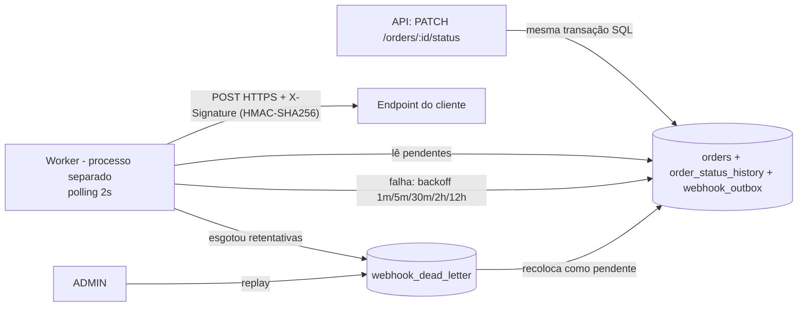

# RFC — Sistema de Webhooks de Notificação de Pedidos

| Campo | Valor |
|---|---|
| **RFC** | RFC-001 |
| **Autor** | Pedro Hubner (a partir da reunião técnica conduzida por Larissa) |
| **Status** | Em revisão |
| **Data** | 2026-10-12 |
| **Revisores** | Larissa (Tech Lead), Marcos (Product Manager), Bruno (Eng. Pleno, Pedidos), Diego (Eng. Sênior, Plataforma), Sofia (Eng. de Segurança) |
| **Documentos relacionados** | [PRD](PRD.md) · [FDD](FDD.md) · [ADRs](adrs/README.md) · [Tracker](TRACKER.md) |
| **Prazo para comentários** | Antes da sessão de revisão de design com Bruno e Diego ([09:50] Larissa) |

---

## 1. Resumo executivo (TL;DR)

Propomos notificar clientes B2B **por webhooks outbound** sempre que um pedido muda de status. A mudança de status passa a gravar um evento numa **tabela outbox no MySQL, na mesma transação** que já atualiza o pedido. Um **worker em processo separado** lê a outbox a cada **2 segundos** e entrega o evento por HTTPS, **assinado com HMAC-SHA256** com uma secret por endpoint. Falhas são retentadas com **backoff exponencial (1m/5m/30m/2h/12h)** e, esgotadas as tentativas, o evento vai para uma **DLQ** que só um ADMIN pode reprocessar. A garantia é **at-least-once**: o cliente deduplica pelo `X-Event-Id`. Tudo é construído com os padrões e a infraestrutura que já existem: Express, Prisma, MySQL, Pino, Zod e `AppError`. **Nenhuma infraestrutura nova.**

## 2. Contexto e problema

Atlas Comercial, MaxDistribuição e Nova Cargo pediram formalmente para ser notificados quando o status dos pedidos deles muda. Hoje fazem polling em `GET /orders`, o que deixa a integração lenta e cara. A Atlas sinalizou que pode migrar para um concorrente se a entrega não sair até o fim do trimestre ([09:00] Marcos). Para os clientes, qualquer coisa **abaixo de 10 segundos** é tempo real ([09:02] Marcos). O fluxo é apenas **de saída**, do OMS para o cliente ([09:02] Marcos).

O OMS não tem hoje nenhum mecanismo de evento, fila ou notificação externa. O único ponto em que o status muda é `OrderService.changeStatus` (`src/modules/orders/order.service.ts`). Ele roda uma transação que já é pesada: atualiza o pedido, grava `order_status_history` e mexe no estoque ([09:04] Bruno). Qualquer solução precisa respeitar duas restrições ao mesmo tempo:

1. **RFC-CTX-01 — Não pode tornar a mudança de status dependente do cliente.** Um cliente lento não pode travar outros pedidos, e um cliente fora do ar não pode causar rollback ([09:04] Bruno).
2. **RFC-CTX-02 — Não pode perder evento.** Se o status mudou, o evento tem que sair ([09:40] Bruno).

## 3. Proposta técnica

### 3.1 Visão geral

### 3.2 Componentes

| ID | Componente | Responsabilidade | Decisão |
|---|---|---|---|
| RFC-PROP-01 | **Gravação na outbox** | Dentro da transação de `changeStatus`, grava um evento para cada webhook ativo do customer que assina o novo status. Se nenhum assina, nada é gravado. O payload é renderizado no momento (snapshot). | [ADR-001](adrs/ADR-001-outbox-transacional-no-mysql.md), [ADR-007](adrs/ADR-007-snapshot-do-payload-e-filtro-na-insercao.md) |
| RFC-PROP-02 | **Worker** | Entry-point próprio (`npm run worker`), mesmo banco, PrismaClient próprio. Polling de 2s, lote pequeno, um único worker. | [ADR-002](adrs/ADR-002-worker-separado-em-polling.md) |
| RFC-PROP-03 | **Entrega HTTP** | POST JSON por HTTPS, timeout de 10s, headers de identificação e assinatura. | [ADR-004](adrs/ADR-004-assinatura-hmac-sha256-com-secret-por-endpoint.md), [ADR-005](adrs/ADR-005-entrega-at-least-once-com-x-event-id.md) |
| RFC-PROP-04 | **Retry e DLQ** | Backoff exponencial 1m/5m/30m/2h/12h (contagem exata em RFC-L-01). Depois, DLQ em tabela própria, com replay manual só para ADMIN. | [ADR-003](adrs/ADR-003-retry-com-backoff-exponencial-e-dlq.md) |
| RFC-PROP-05 | **API de configuração** | CRUD de webhooks por customer, rotação de secret e histórico de entregas. | [ADR-006](adrs/ADR-006-reuso-dos-padroes-existentes-do-projeto.md) |
| RFC-PROP-06 | **Módulo** | `src/modules/webhooks/` (novo), igual aos demais módulos, com erros `WEBHOOK_*`. | [ADR-006](adrs/ADR-006-reuso-dos-padroes-existentes-do-projeto.md) |

### 3.3 Contrato com o cliente, em alto nível

- **RFC-PROP-07 — Evento único da v1:** `order.status_changed`, com dados enxutos do pedido e sem itens ([09:43] Diego).
- **RFC-PROP-08 — Segurança:** só `https`, HMAC-SHA256 do corpo, uma secret por endpoint e rotação com 24h de convivência entre a secret antiga e a nova ([09:20]–[09:23] Sofia).
- **RFC-PROP-09 — Semântica:** at-least-once. Ordem só por pedido, no fluxo normal e com um único worker ([09:13] Larissa, [09:26] Larissa). Sob retry a ordem pode inverter (RFC-L-04).

Endpoints, payloads, headers, códigos de erro e fluxos estão detalhados no [FDD](FDD.md).

### 3.4 Plano de entrega

**RFC-PLAN-01** — Estimativa de **três sprints**, com a revisão de segurança da Sofia incluída ([09:46]–[09:47] Larissa):

| Bloco | Esforço |
|---|---|
| Modelagem de outbox e DLQ | 1 sprint |
| Worker e retry | 1 sprint |
| CRUD de configuração e histórico de entregas | ½ sprint |
| Integração em `order.service` e testes ponta a ponta | ½ sprint |
| HMAC, schemas e validações, mais revisão de segurança (≥ 2 dias úteis, a agendar antes do deploy, [09:46] Sofia, [09:49] Sofia) | dentro das 3 sprints |

Meta do cliente-âncora: **fim de novembro** ([09:45] Marcos).

## 4. Alternativas consideradas

| # | Alternativa | Por que foi descartada (trade-off) | Fonte |
|---|---|---|---|
| RFC-ALT-01 | **Disparo HTTP síncrono dentro de `changeStatus`** | Acopla a latência e a disponibilidade do cliente à transação de pedidos. Um cliente lento trava mudanças de status de outros pedidos, e um cliente fora do ar forçaria rollback de uma mudança válida. Ganharia em simplicidade, mas perderia isolamento e confiabilidade. | [09:04] Bruno, [09:06] Diego |
| RFC-ALT-02 | **Redis Streams ou outro broker** | Mais reativo e feito para mensageria, mas exige subir e operar infraestrutura nova (Redis Cluster), o que é overengineering para um time pequeno. *(Observação técnica nossa, não discutida na reunião: sem transação distribuída, a atomicidade com o MySQL também se perderia.)* | [09:07] Larissa, [09:07] Diego |
| RFC-ALT-03 | **Trigger no MySQL para acordar o worker** | O MySQL não tem `LISTEN/NOTIFY`, e um trigger só executa SQL: avisar um processo externo exigiria improviso. Ganharia latência, mas perderia simplicidade e robustez. O polling de 2s já cumpre a meta de 10s. | [09:09] Bruno, [09:09] Diego |
| RFC-ALT-04 | **Retry indefinido** ou **só 3 tentativas** | Retry indefinido deixa evento pendurado para sempre quando o cliente some. Três tentativas desistem em cerca de 30 minutos, menos do que manutenções reais de 2h. | [09:15] Diego, [09:16] Bruno, [09:16] Diego |
| RFC-ALT-05 | **Marcar `failed` na própria outbox em vez de DLQ separada** | Polui a leitura da outbox principal. Uma tabela dedicada serve de evidência para debug e reprocessamento. | [09:17] Larissa, [09:18] Diego |
| RFC-ALT-06 | **Secret global da plataforma** | Mais simples de gerenciar, mas se vaza uma, vaza tudo, e não dá para rotacionar a credencial de um cliente sem afetar os demais. | [09:21] Sofia |
| RFC-ALT-07 | **Exactly-once** | Tiraria do cliente o trabalho de deduplicar, mas exige coordenação dos dois lados e é bem mais complexo. At-least-once com `event_id` resolve a grande maioria dos casos e é o padrão de Stripe e GitHub. | [09:25] Diego |
| RFC-ALT-08 | **Guardar só `order_id` e renderizar o payload no envio** | O evento passaria a refletir o estado atual do pedido, não o do momento da mudança. | [09:51] Bruno, [09:52] Larissa |

## 5. Questões em aberto

### 5.1 Levantadas na reunião e não decididas, ou adiadas

| # | Questão | Situação | Fonte |
|---|---|---|---|
| RFC-Q-01 | **Rate limiting de envio por cliente.** Se 50 pedidos de um cliente mudam de status em um minuto, enviamos 50 chamadas? | Fora do escopo da v1: **observar e decidir depois** com dados reais. | [09:38] Diego, [09:39] Larissa |
| RFC-Q-02 | **Notificar o cliente quando o webhook dele está falhando** (por exemplo, e-mail após 3 falhas seguidas). | **Adiado para a próxima fase**, depois de medir impacto. | [09:37] Marcos, [09:37] Larissa |
| RFC-Q-03 | **Escalar para vários workers.** Hoje a ordem por `order_id` depende de haver um único worker. Opções citadas: particionar por `order_id` ou usar lock pessimista. | **Adiado** ("problema do futuro"). Registrado como limitação conhecida. | [09:13] Diego, [09:13] Larissa |
| RFC-Q-04 | **Endurecer a autorização do CRUD de webhooks.** Na v1, qualquer role autenticada pode gerenciar webhooks. Como o JWT atual só carrega `id`, `email` e `role` (`src/middlewares/auth.middleware.ts`), não há vínculo usuário–cliente para restringir por customer. | "Por enquanto sim. Mais pra frente a gente pode endurecer." | [09:37] Sofia |
| RFC-Q-05 | **Arquivar os eventos entregues** (algo como 30 dias). | **Fora do escopo** desta feature. A tabela cresce até lá. | [09:08] Diego |

### 5.2 Lacunas identificadas na elaboração deste RFC, para os revisores decidirem

Estes pontos **não foram decididos na reunião**. Aparecem quando decisões tomadas lá são combinadas entre si. A proposta do FDD para cada um é provisória até a revisão.

| # | Lacuna | Decisões de origem | Proposta provisória |
|---|---|---|---|
| RFC-L-01 | **"5 tentativas" vs. 5 intervalos.** A soma de "quase 15 horas" só fecha com 5 *retentativas* depois do envio inicial (6 envios HTTP). Mas o resumo final fala em "total 5 tentativas", o que aponta para 5 envios e só 4 intervalos (~2h36min). | [09:15] Diego, [09:17] Diego, [09:17] Larissa, [09:48] Larissa | 1 envio + 5 retentativas (1m/5m/30m/2h/12h). Diego precisa confirmar. |
| RFC-L-02 | **Assinatura durante o grace period de 24h.** Para a secret antiga "continuar válida", o envio precisa ser verificável com ela. Assinamos com as duas? | [09:21] Sofia | Durante o grace, a requisição leva as duas assinaturas. Sofia precisa validar. |
| RFC-L-03 | **`X-Timestamp` fora da assinatura.** A decisão assina só o corpo. Assim, um atacante pode reenviar uma requisição antiga trocando o `X-Timestamp`, o que enfraquece a detecção de replay que motivou o header. | [09:22] Sofia, [09:44] Diego | Levar para a revisão de segurança. A v1 segue a decisão (só o corpo). |
| RFC-L-04 | **Ordem sob retry.** Com single-worker, um evento em backoff (por exemplo, `PAID` aguardando 5 min) pode ser ultrapassado por um evento mais novo do mesmo pedido (`PROCESSING`). | [09:12] Diego, [09:17] Larissa | Documentar como limitação. O cliente usa o momento da mudança, presente no payload, para descartar estado antigo. Bloquear a fila por pedido fica para decisão do time. |
| RFC-L-05 | **Como o ADMIN descobre o `:id` da DLQ** para o replay. A reunião definiu o replay, mas não uma listagem. | [09:18] Diego | Na v1, consulta via banco ou logs. Uma listagem administrativa fica para decisão do time. |
| RFC-L-06 | **Armazenamento da secret em repouso.** HMAC exige a secret original, então não dá para guardar só o hash. | [09:46] Sofia | Avaliar na revisão de segurança. |
| RFC-L-07 | **Evento na criação do pedido.** A reunião tratou só de mudança de status em `changeStatus`. A criação (`null → PENDING`, em `create`) não foi discutida. | [09:40] Bruno | A v1 publica só em `changeStatus`. Incluir a criação é decisão de produto (Marcos). |

## 6. Impacto e riscos

**Impacto no sistema existente**
- **`OrderService.changeStatus`** ganha uma leitura (webhooks do customer) e N inserções dentro da transação. Se a inserção falhar, a mudança de status dá rollback, e isso é intencional ([09:40] Bruno).
- **Banco:** 4 tabelas novas, todas com UUID ([09:51] Larissa), e carga de polling constante.
- **Operação:** um processo novo (`npm run worker`) para implantar e monitorar.
- **Clientes:** precisam implementar verificação HMAC e deduplicação por `event_id`. O PM documenta isso no portal ([09:26] Marcos, [09:40] Marcos).

**Riscos principais.** A matriz completa, com probabilidade e impacto, está no [PRD](PRD.md#10-riscos-e-mitigação).

| ID | Risco | Mitigação proposta |
|---|---|---|
| RFC-RISK-01 | Atraso frente ao prazo de fim de novembro, com risco de churn da Atlas | Escopo enxuto. Fora de escopo: e-mail, dashboard e rate limiting. Estimativa de 3 sprints já inclui a revisão de segurança. |
| RFC-RISK-02 | Worker parado acumula eventos (sem perda, mas com latência) | Processo separado ([09:11] Diego). Proposta do FDD: alerta pela idade do evento pendente mais antigo. |
| RFC-RISK-03 | Vazamento de secret | Secret por endpoint e rotação com grace de 24h ([09:21] Sofia). Proposta do FDD: redaction da secret nos logs do OMS. |
| RFC-RISK-04 | Cliente sem deduplicação processa duplicado | Contrato at-least-once destacado no portal do desenvolvedor ([09:26] Marcos). |
| RFC-RISK-05 | Rajada de eventos sobrecarrega o cliente | RFC-Q-01: observar e decidir depois. |

## 7. Decisões relacionadas

| ADR | Decisão |
|---|---|
| [ADR-001](adrs/ADR-001-outbox-transacional-no-mysql.md) | Outbox transacional no MySQL existente |
| [ADR-002](adrs/ADR-002-worker-separado-em-polling.md) | Worker em processo separado, polling de 2s, single-worker |
| [ADR-003](adrs/ADR-003-retry-com-backoff-exponencial-e-dlq.md) | Retry com backoff 1m/5m/30m/2h/12h e DLQ com replay ADMIN |
| [ADR-004](adrs/ADR-004-assinatura-hmac-sha256-com-secret-por-endpoint.md) | HMAC-SHA256, secret por endpoint, rotação com grace de 24h |
| [ADR-005](adrs/ADR-005-entrega-at-least-once-com-x-event-id.md) | At-least-once com `X-Event-Id` |
| [ADR-006](adrs/ADR-006-reuso-dos-padroes-existentes-do-projeto.md) | Reuso dos padrões existentes (módulo, `AppError`, `WEBHOOK_*`, Pino) |
| [ADR-007](adrs/ADR-007-snapshot-do-payload-e-filtro-na-insercao.md) | Payload enxuto como snapshot e filtro na inserção |
